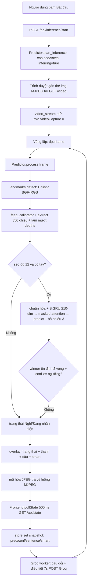

# PROJECT_ARCHITECTURE.md — VSL Translator

> Nguồn chuẩn là code. Tài liệu này được viết lại ngày 2026-10-26 để khớp
> nhánh `test-architecture`: 12 frame / 356-dim / BiGRU + masked attention +
> velocity (arch v2, xem `backend/CHANGELOG.md`).

## 1. Tổng quan

Bộ dịch Ngôn ngữ ký hiệu Việt Nam (VSL): nhận diện ký hiệu rời rạc qua webcam,
ghép câu, làm sạch câu bằng LLM, hỗ trợ giọng nói vào/ra và tra cứu ảnh ký hiệu.

Vòng lặp cốt lõi: `landmark MediaPipe Holistic (từng frame) → vector 356 chiều
theo bộ xương chuẩn (canonical-skeleton) → cửa sổ 12 frame → bộ phân loại
BiGRU hai chiều (Keras/TensorFlow) + masked attention → làm mượt bằng bỏ phiếu
đa số + hysteresis → chốt từ → làm sạch câu bằng Groq LLM → overlay + giao diện
web + TTS`.

**Ngăn xếp công nghệ chính:**

| Lớp | Công nghệ |
|---|---|
| Tư thế / bàn tay | MediaPipe Holistic 0.10.21 (`model_complexity=2`, `min_detection/tracking=0.01`, `smooth_landmarks=True`), thu hình/kết xuất bằng OpenCV |
| Học máy | TensorFlow 2.18.1 + Keras (`Bidirectional GRU`, `Masking`, masked `WeightedMean`, `FrameVelocity`, `CategoricalFocalCrossentropy`), scikit-learn (`train_test_split`, `compute_class_weight`, báo cáo), SciPy (`interp1d` cho time-warp) |
| Script backend | CLI Python trong `backend/scripts/` (`train.py`, `realtime_predict.py`, `predict.py`, `collect_data.py`, `groq_client.py`, `overlay.py`, `manage_classes.py`, `manage_model.py`, `kfold_eval.py`, `profile_robustness.py`, `stress_test.py`) |
| Web server | Chỉ dùng stdlib: `http.server.ThreadingHTTPServer + BaseHTTPRequestHandler`; bảng điều phối tự viết trong `frontend/app/router.py` |
| Giao diện web | HTML/CSS tĩnh + module JS thuần (`static/js/api/*`, `store/store.js`, `ui/*`, `sign/*`); luồng MJPEG dạng thẻ `` tại `GET /video` |
| Gói inference độc lập | `VSLInference/` — landmarks + model vendored, không import `backend/` |
| Giọng nói | `SpeechRecognition 3.17.0 + PyAudio` (STT, `vi-VN`, backend Google), `gTTS 2.5.4` (TTS, `lang=vi`, `tld=com.vn` → dự phòng `com`) |
| Làm sạch bằng LLM | Client `openai` trỏ tới endpoint tương thích OpenAI của Groq (`GROQ_BASE_URL`, model mặc định `qwen/qwen3.8-27b`, temp 0, `max_tokens=256`), mẫu prompt `backend/TXT_NOISE_RMV_PROMPT.md` với ô giữ chỗ `{{Predict}}` |
| Nhãn | 8 lớp trong `backend/actions.json`: `camon, xinchao, toi, khoer, khochiu, tambiet, tinhthanh, diachi` |
| Sản phẩm tạo ra | `backend/models/model.keras + feature_stats.npz + test_set.npz + train_record.json`, thư mục `models/backups/backup_*` theo thời gian, `logs/` cho TensorBoard |

## 2. Kiến trúc tổng thể

Phong cách: **monolith phân lớp với hai front-end dùng chung một lõi suy luận**,
cộng một gói inference độc lập vendored.

- **Thư viện lõi ML** (`backend/src/vsl_translator/`): hàm thuần cho đặc trưng
  (`landmarks.py`), dữ liệu (`dataset.py`), mô hình (`model.py`), điều khiển huấn
  luyện (`callbacks.py`). Không có tác dụng phụ I/O ngoài đọc config.
- **Lớp batch/CLI** (`backend/scripts/`): huấn luyện, thu thập dữ liệu, đánh giá
  offline, vòng lặp realtime OpenCV độc lập. Dùng để phát triển mô hình.
- **Lớp dịch vụ web** (`frontend/`): HTTP server dùng stdlib + `app/router.py`
  (bảng điều phối) + `app/routes/` (adapter HTTP mỏng) + `app/services/`
  (singleton có trạng thái + logic nghiệp vụ) + giao diện JS tĩnh.
  `services/predictor.py` mirror logic từ `scripts/realtime_predict.py` thành
  phương thức `Predictor.process(frame)` theo từng frame.
- **Gói độc lập** (`VSLInference/`): `landmarks.py` + `inference.py` + `_config.py`
  vendored từ backend, chỉ phụ thuộc third-party (keras, mediapipe, opencv,
  numpy). Không import `backend/`, không thao tác `sys.path`. Dùng khi cần
  inference nhúng mà không mang cả backend theo.
- **Xuyên suốt**: `backend/config.py` là nguồn sự thật duy nhất (đường dẫn, siêu
  tham số, ngưỡng, cấu hình Groq, bộ nạp `.env`, `set_groq_api_key()`).

Mô hình đồng thời: HTTP server đa luồng (mỗi request một luồng) + một vòng lặp
thu hình OpenCV do luồng xử lý `/video` sở hữu + một luồng daemon Groq
`smart_worker` cho mỗi `Predictor` + một luồng `listen_in_background` cho STT.
Trạng thái dùng chung được bảo vệ bằng `threading.Lock` bên trong `Predictor`,
`SmartSentence`, `SpeechToText`.

```
[Webcam] → [MediaPipe] → [extract() 356 chiều] → [deque(12)] → [chuẩn hóa → BiGRU 210-dim → masked attention → bỏ phiếu(3) + hysteresis(2)]
    → [danh sách câu] → [Groq worker] → [overlay MJPEG + JSON /api/state + gTTS/SR]
```

## 3. Cấu trúc thư mục

```text
vsl-translator/
├── requirements.txt              # tf, mediapipe, opencv, sklearn, openai, gtts, SR, PyAudio
├── README.md
├── PROJECT_ARCHITECTURE.md       # file này
├── PIPELINES.md                  # luồng suy luận live + huấn luyện (mermaid)
├── try_vsl.py                    # demo VSLInference
├── VSLInference/                 # gói inference độc lập (vendored)
│   ├── landmarks.py              # copy của backend landmarks (356-dim)
│   ├── inference.py              # VSLInference + WeightedMean/Slice/FrameVelocity vendored
│   ├── _config.py                # config rút gọn (ngưỡng, actions)
│   └── server.py                 # server demo cho gói độc lập
├── backend/
│   ├── config.py                 # hằng số trung tâm, bộ nạp .env, bộ nạp actions
│   ├── actions.json              # 8 nhãn lớp
│   ├── .env                      # GROQ_API_KEY (ghi bởi PUT /api/config/groq-key)
│   ├── TXT_NOISE_RMV_PROMPT.md   # mẫu system prompt cho Groq
│   ├── src/vsl_translator/       # lõi ML có thể import
│   │   ├── landmarks.py          # detect/draw/extract, calibrator/smoother, hằng số chiều
│   │   ├── dataset.py            # nạp/tăng cường/chuẩn hóa, giữ nguyên mặt nạ zero
│   │   ├── model.py              # build_model(), WeightedMean, Slice, FrameVelocity
│   │   └── callbacks.py          # CosineAnnealingWarmup, TrainingMonitor, SmartEarlyStopping
│   ├── scripts/                  # điểm vào CLI
│   │   ├── train.py              # chia train/val/test chống rò rỉ + tăng cường + checkpoint + train_record.json
│   │   ├── kfold_eval.py         # K-fold đúng pipeline train.py (thước chính khi test nhỏ)
│   │   ├── profile_robustness.py # sweep từng loại nhiễu riêng lẻ trên test_set
│   │   ├── stress_test.py        # đánh giá dưới nhiễu live-like + partial windows
│   │   ├── realtime_predict.py   # vòng lặp live OpenCV (logic suy luận tham chiếu)
│   │   ├── _common.py            # load_classifier + extract_frame_vector dùng chung
│   │   ├── inference.py          # wrapper inference CLI
│   │   ├── collect_data.py       # thu .npy qua webcam theo từng action (+ meta.json device)
│   │   ├── predict.py / predict_live.py / realtime_test.py / cam_test.py
│   │   ├── groq_client.py        # call_groq, SmartSentence, smart_worker
│   │   ├── overlay.py            # chữ Unicode PIL, thanh confidence, panel câu
│   │   ├── manage_classes.py / manage_model.py / add_noise.py / migrate_data.py
│   │   └── server.py / stream_session.py  # server/streaming cũ (đường backend)
│   ├── tests/                    # test_arm_depths, test_far_bias, test_hysteresis, ...
│   ├── data/<action>/<seq>/*.npy # chuỗi 12 frame đã thu thập (+ meta.json/seq)
│   ├── models/                   # model.keras, feature_stats.npz, test_set.npz, train_record.json, backups/
│   └── logs/                     # log TensorBoard
└── frontend/
    ├── server.py                 # ThreadingHTTPServer + Handler (GET/POST/PUT/DELETE)
    ├── caller.py                 # shim deprecated, re-export services
    ├── app/
    │   ├── router.py             # ROUTES {(method,path): handler}
    │   ├── routes/               # config, frames, inference, sentences, smart, state, stt, tts, static
    │   └── services/             # predictor, client_frames, groq_facade, state, video_stream, stt, tts
    └── static/                   # index.html, css, js/{api,store,ui,sign}/
```

Bỏ qua/không quan trọng: `venv/`, `__pycache__/`, `.git/`, `.DS_Store`,
các bản sao cũ `backend/data_*`.

## 4. Module và thành phần cốt lõi

### 4.1 `backend/src/vsl_translator/landmarks.py` — trích xuất đặc trưng

Module này biến kết quả thô của MediaPipe Holistic thành vector 356 chiều bất
biến với vóc dáng người và khoảng cách camera. Ý tưởng trung tâm là bộ xương
chuẩn (canonical skeleton): thay vì dùng tọa độ pixel tuyệt đối, mọi khớp được
tái dựng lại trong một hệ tọa độ chuẩn rồi mới đưa vào mô hình.

- `create_model()` dựng `mp_holistic.Holistic` từ giá trị trong `config.py`.
- `detect(image, model)`: BGR→RGB, `flags.writeable=False`, `model.process()`,
  chuyển ngược lại. Hàm thuần theo từng lần gọi.
- `normalize_frame(frame)`: letterbox mọi frame về canvas vuông chuẩn
  (`FRAME_STD_SIZE`, hiện 720), giữ tỉ lệ; trả về frame chuẩn + meta
  (kích thước gốc, scale, pad).
- `extract(results, frame_shape, neutral_lens) → np[356]`: hợp đồng mà mọi
  thành phần khác phụ thuộc (xem bố cục §4.1.1).

#### 4.1.1 Bố cục vector 356 chiều

| Đoạn | Chỉ số | Nội dung |
|---|---|---|
| Pose trái | [0:9] | vai trái, khuỷu trái, cổ tay trái, mỗi khớp 3 số `(x, y, vis)` |
| Pose phải | [9:18] | vai phải, khuỷu phải, cổ tay phải |
| Tay trái | [18:60] | 21 điểm tay trái, mỗi điểm 2 số `(x, y)` đã chuẩn hóa |
| Tay phải | [60:102] | 21 điểm tay phải, tương tự |
| Độ sâu tay | [102:104] | tỉ số rút ngắn phối cảnh của tay trái và phải |
| Offset vai–tay trái | [104:230] | 21 điểm × 3 neo × 2 tọa độ = 126 |
| Offset vai–tay phải | [230:356] | tương tự cho tay phải |

Mặt, thân dưới và trục z của pose bị loại bỏ. Trục z chỉ còn xuất hiện gián tiếp
qua số hạng hiệu chỉnh trong `arm_depths`. Visibility được giữ nguyên, không
chuẩn hóa. `POSE_DIM=18, HAND_DIM=42, ARM_DEPTH_DIM=2, SH_OFF_REF_DIM=126,
SH_OFF_DIM=252, BODY_ONLY_DIM=356`.

#### 4.1.2 Nhóm pose 18 chiều — ghim vai + động học thuận

Tọa độ thô của MediaPipe phụ thuộc chiều cao, tỉ lệ tay và khoảng cách camera
nên không thể so sánh trực tiếp giữa các phiên. Hàm `_retarget_arm` khắc phục
bằng cách ghim hai vai vào vị trí cố định rồi tái dựng tay theo hướng xương gốc:

1. Vai trái ghim tại `(-0.5, 0)`, vai phải tại `(+0.5, 0)`.
2. Tính vector xương thô `upper = khuỷu − vai`, `fore = cổ tay − khuỷu` trong
   tọa độ chuẩn hóa của ảnh.
3. Chuẩn hóa mỗi vector thành unit vector bằng `_unit_vec`; vector rỗng hoặc
   không hữu hạn trả về `(0, 0)` để hàm giữ thuần túy theo từng frame, không rò
   rỉ hướng từ frame trước.
4. Khuỷu chuẩn = vai chuẩn + hướng trên × `STD_UPPER_ARM (1.2)`; cổ tay chuẩn =
   khuỷu chuẩn + hướng dưới × `STD_FOREARM (1.0)`.

Kết quả: tay dài hay ngắn, đứng gần hay xa camera đều cho cùng độ dài chuẩn,
chỉ còn hướng chuyển động được giữ lại.

#### 4.1.3 Nhóm tay 84 chiều — chuẩn hóa theo lòng bàn tay của chính nó

Mỗi bàn tay được xử lý độc lập trong `_process_hand`, không tham chiếu vai
hay mặt:

1. Lấy 21 điểm `(x, y)` thô; sai hình dạng trả về `zeros(42)`.
2. Tịnh tiến mọi điểm về cổ tay của chính detector đó: `pts − pts[0]`.
3. Tính `palm_size = max(|cổ tay − mcp9|, |mcp5 − mcp17| × 1.25)`.
4. Chia cho `palm_size`, nhân với `STD_PALM (0.4)`, dẹt thành 42 số.

Ngưỡng `MIN_PALM_SIZE (0.012)` lọc lòng bàn tay suy biến; dưới ngưỡng trả về
`zeros(42)`.

#### 4.1.4 Nhóm offset vai 252 chiều — vị trí tay so với thân trên

`_shoulder_offsets` bù lại vị trí tay trước ngực/mặt bằng vector từ mỗi điểm tay
tới 3 neo trên thân (vai trái nâng + vai phải nâng + trung điểm; vai nâng = giữ
x vai, nâng y lên bằng y tâm mặt từ `_get_face_center`). Mỗi tay tính
`(21 điểm − neo) / palm_size × 0.4` cho từng neo theo đúng thứ tự, dẹt mỗi khối
thành 42, nối thành 126 mỗi tay. Tay mất, neo mất hoặc palm suy biến cho
`zeros(126)` ở bên đó.

#### 4.1.5 Nhóm độ sâu tay 2 chiều — bù phối cảnh tiến/lùi camera

`_compute_arm_depth_ratio` ước lượng foreshortening: đo độ dài pixel
`|vai−khuỷu| + |khuỷu−cổ tay|`, chia cho `neutral_len` hiệu chuẩn theo phiên,
cộng số hạng phụ `Z_GAIN (2.0) × (wrist.z − shoulder.z)`, kẹp vào `[0.3, 2.0]`,
mặc định `1.0` khi bên đó bị chặn. `ArmDepthCalibrator` hiệu chuẩn độ dài tay
trung tính (trung vị sau `ARM_DEPTH_CAL_WARMUP = 20` frame). `ArmDepthSmoother`
lọc EMA α=0.4 trên trung vị cửa sổ 5, chỉ áp trên đường live để dữ liệu train
giữ nguyên thô.

#### 4.1.6 Cổng chặn và hằng số

- Vai thiếu hoặc `visibility < 0.5` → cả frame `zeros(356)`; lớp `Masking(0.0)`
  của mô hình sẽ bỏ qua frame này trong bước hồi tiếp.
- Thiếu khuỷu/cổ tay một bên → 9 số pose + 42 số tay + 126 số offset của bên đó
  giữ zero, bên còn lại nguyên vẹn.
- Cổng tay nghỉ: cổ tay chuẩn có `y > IDLE_WRIST_Y_MAX (1.75)` và
  `|x| < IDLE_WRIST_X_MAX (0.95)` → coi như tay buông thõng, zero hóa bên đó
  nhưng vẫn giữ giá trị depth vừa đo.

### 4.2 `backend/src/vsl_translator/model.py` — bộ phân loại (arch v2)

`build_model(n_actions, sequence_len=12, n_features=356)`, khẳng định đầu vào
356 chiều:

```text
Input(12,356) → Masking(0.0)
  → Slice 4 nhóm: pose 18 / tay 84 / depths 2 / offsets 252
  → 4× LayerNormalization (pre-norm)
  → nhánh static: pose→Dense32 / tay→Dense64 / offset→Dense64, + depths → Concat 162
  → nhánh motion: FrameVelocity trên slice RAW pose+tay → LN → Concat 102 → Dense48 → LN
  → Concat(static 162 + motion 48) = 210
  → BiGRU(48, return_sequences) → LN → Dropout(0.4)
  → BiGRU(48, return_sequences) → LN → Dropout(0.4)
  → Dense(1,tanh) điểm số + WeightedMean masked (softmax theo thời gian) → (B,96)
  → Dense(64,relu,l2=1e-4) → LN → Dropout(0.4)
  → Dense(64,relu,l2=1e-4) → LN → Dropout(0.3)
  → Dense(n_actions,softmax)
```

Biên dịch với `Adam(lr=1e-3, clipnorm=1.0)`, hàm mất mát
`CategoricalFocalCrossentropy(alpha=1.0, gamma=1.0, label_smoothing=0.02)`,
metric `categorical_accuracy`. Params trainable ~157k.

Các layer tùy biến (đều `@register_keras_serializable`, save/load `.keras`
không cần `custom_objects` ở phía backend):

- `WeightedMean` — masked attention: cộng `-1e9` vào score của frame bị mask
  trước softmax, frame miss đóng góp ~zero trọng số.
- `Slice(start, end)` — cắt nhóm đặc trưng nhưng vẫn truyền mask qua.
- `FrameVelocity` — `v[t] = x[t] − x[t−1]`, `v[0] = 0`; chỉ tính khi cả hai
  frame đều non-zero; truyền mask qua. Tính trên slice RAW trước norm.

Lý do kiến trúc: offset 252/356 dim lấn át hand-shape sau concat nên phải
projection cân bằng (pose 32 / tay 64 / offset 64); velocity cho trên slice raw
để phân biệt các động tác cùng vị trí nhưng khác hướng/tốc độ
(`xinchao/khoer/diachi`, `toi/khochiu/tambiet`).

### 4.3 `backend/src/vsl_translator/dataset.py` — pipeline dữ liệu

- `load_raw_dataset()`: duyệt `data/<action>/<seq>/*.npy` (đúng 12 frame
  `0.npy…11.npy`), xếp thành `(N,12,356)` + nhãn one-hot. Đọc `meta.json` mỗi
  sequence lấy `device` (mặc định `"legacy"`). Không augment, không chuẩn hóa.
- `augment_train_data(X, y, augment_factor=8)`: chỉ trong bộ nhớ, chỉ trên split
  train — nhiễu Gauss (`NOISE_STD=0.05`), jitter tỉ lệ (`0.05`), biến dạng thời
  gian (`TIME_WARP_SIGMA=0.2` qua `interp1d` + zero lại mask tại `<0.99`), dịch
  chuyển (`±0.02`), rớt frame (`0.05`), dropout một tay (`0.5`, skip mẫu một
  tay), hoán đổi tay (`0.3`, skip mẫu một tay), chèn tay nghỉ
  (`INACTIVE_INJECT_PROB=0.15`). `_coord_mask` loại visibility và `arm_depths`
  khỏi các phép tăng cường tọa độ; mặt nạ `sequence != 0.0` được giữ tuyệt đối.
- `standardize_features(X, mean, std)`: z-score nhưng giữ nguyên giá trị zero
  tuyệt đối (zero vẫn là zero để `Masking` hoạt động). Stats tính trên train-aug
  bằng nanmean/nanstd (bỏ qua entry 0.0), lưu vào `models/feature_stats.npz`.
- `collect_data.py --action <name> [--sequences N] [--device LABEL]`: thu
  `N_SEQUENCES=15` × `SEQUENCE_LEN=12` vector qua `extract()` trực tiếp, đánh số
  nối tiếp không ghi đè, ghi `meta.json` `{device, src_shape, std_size}` mỗi
  sequence, in số zero-frame để loại sequence hỏng ngay khi thu.

### 4.4 `backend/src/vsl_translator/callbacks.py` + `scripts/train.py`

- `CosineAnnealingWarmup(lr_max=1e-3, lr_min=1e-6, warmup=10, total=EPOCHS=200)`
  — bộ điều khiển LR duy nhất.
- `TrainingMonitor` — bảng điều khiển theo từng epoch + cảnh báo khoảng cách
  overfit (`0.25`).
- `SmartEarlyStopping` — patience 60 / `min_delta=1e-4` từ epoch 30, mục tiêu
  (`val_acc≥0.98`, `val_loss≤0.05`), patience đột biến loss 15, patience bão hòa
  30, patience khoảng cách overfit 30.
- Pipeline `train.py`: sao lưu model cũ (`models/backups/`, giữ 5 bản) → nạp raw
  (+ devices) → chia stratified action×device (giữ lại test 15% trước, rồi val
  15% trên tổng; fallback stratify action-only khi nhóm device quá nhỏ) → lưu
  `test_set.npz` → chỉ tăng cường train → thống kê chỉ từ train →
  `ModelCheckpoint(val_loss)` + TensorBoard → nạp lại trọng số tốt nhất → báo
  cáo train-aug / train-sạch / val / test giữ lại + ma trận nhầm lẫn + phân tích
  confidence + ghi `models/train_record.json` (hyperparams, history, metrics,
  report, confusion). Cân bằng lớp bằng `compute_class_weight('balanced')` trên
  nhãn đã tăng cường.

### 4.5 Đánh giá: kfold / robustness / stress

- `scripts/kfold_eval.py --folds 5 [--preset base|strong]`: chạy đúng pipeline
  train K lần trên các fold khác nhau, báo mean/worst-fold acc + margin
  (top1−top2) + per-class acc. Thước chính khi held-out test chỉ ~54 mẫu.
- `scripts/profile_robustness.py`: sweep từng nhiễu riêng lẻ trên `test_set.npz`
  (noise, warp, drop, shift, scale-jitter, burst, speed-cut, hand ops ở p=1.0).
- `scripts/stress_test.py --repeats N`: nhiễu live-like mạnh hơn train + partial
  sliding windows overlap ≥50%; báo clean acc, stress acc, per-class confidence,
  top confused pairs.

### 4.6 Realtime: `scripts/realtime_predict.py` so với `services/predictor.py`

Cùng một máy trạng thái, hai vật chủ: vòng lặp OpenCV độc lập so với singleton
web (`Predictor.process(frame)` cho mỗi frame MJPEG).

Trạng thái: `seq: deque(12)`, `votes: deque(3)`, `calibrator`, `smoother`,
`probs`, `pred_idx`, `no_hand_frames`, `sentence[]`, `last_committed`,
`_challenger/_challenger_runs` (hysteresis). Mỗi frame: `detect →
feed_calibrator → extract → làm mượt depths[102:104] → nối vào → nếu đầy:
chuẩn hóa → model.predict → bỏ phiếu đa số 3 + ngưỡng 0.60 (per-class override
qua `threshold_for`) + hysteresis (challenger thắng 2 vòng liên tiếp mới đổi) →
pred_idx → chốt từ một lần mỗi lần đổi người thắng`. 5 frame liên tiếp không tay
sẽ xóa `seq/votes/probs/last_committed`. Overlay qua `scripts/overlay.py`.

`scripts/_common.py` gom `load_classifier` + `extract_frame_vector` dùng chung
cho `stream_session.py`, `predict_live.py`, `convenient_predict.py`, `server.py`
đường backend.

### 4.7 `scripts/groq_client.py` + `services/groq_facade.py`

- `call_groq(raw, template, key)`: `OpenAI(base_url=GROQ_BASE_URL).chat.completions.create(model=GROQ_MODEL, temp=0, top_p=1, max_tokens=256)`, system prompt = mẫu đã thay `{{Predict}}`, cắt dấu ngoặc kép/tiền tố `output:`, báo lỗi khi rỗng.
- `SmartSentence`: vật chứa `{text, pending, error, _last_sent, _last_err_time, _force_retry}` an toàn luồng với `set_result/set_error/mark_pending/retry_now/clear/read`.
- `smart_worker(get_sentence, smart, stop, is_active)`: thăm dò mỗi `SMART_POLL_INTERVAL=0.1s`; chỉ gọi khi câu thay đổi, điều tiết `SMART_CALL_INTERVAL=7.0s`, nguội lỗi `SMART_RETRY_INTERVAL=15s`; bỏ qua khi không suy luận trừ khi bị ép.
- `FrontendGroqCaller(get_sentence, is_active)`: sở hữu một `SmartSentence` + worker daemon cho mỗi `Predictor`; `retry()` ưu tiên câu frontend gửi lên, dự phòng câu backend đang giữ, cuối cùng thúc worker.

### 4.8 Máy chủ frontend: `server.py` + `app/router.py` + `routes/` + `services/`

- `server.py:Handler` (stdlib, không framework): `POST/PUT` phân tích JSON body →
  `router.dispatch(method,path,payload)` → JSON `(status, dict)` hoặc nhị phân
  `(status, bytes, mime)`; `GET /api/*` tương tự; `GET /video` truyền JPEG
  `multipart/x-mixed-replace` từ `video_stream(predictor)`; còn lại do
  `routes/static.py` phục vụ trong `static/` (chặn path-traversal).
- Bảng route (khớp chính xác): `POST /api/inference/start|stop`, `GET|DELETE /api/sentences`, `DELETE /api/sentences/last`, `POST /api/smart/retries`, `PUT /api/config/groq-key`, `GET /api/state|health|stt`, `POST /api/stt/start|stop`, `POST /api/tts` (trả `audio/mpeg`), `POST /api/frames` (nhận frame từ client).
- Services: `predictor.py` (singleton model + MediaPipe, bật/tắt suy luận, thao
  tác câu, `snapshot()`), `state.py`, `video_stream.py` (`_stream_lock` một
  client, chỉ mở `cv2.VideoCapture(0)` khi đang suy luận), `client_frames.py`
  (nhận frame upload từ browser), `stt.py`, `tts.py` (cache SHA1→bộ nhớ (50) +
  `/tmp/vsl_tts_*.mp3`, thử lại `com.vn→com`).
- JS: `api/client.js` (phong bì `{ok,data|error}`, `ApiError`), mỗi endpoint một
  module, `store/store.js` (`state` + `set()` + `subscribe`), `main.js` nối nút
  bấm → API → `store.set` → render; vòng thăm dò `pollState(500ms)`; `/video`
  gắn/gỡ dạng `` trong `ui/streamView.js` hoặc `cameraCapture.js` upload
  frame; `sign/` chuyển văn bản gõ thành ảnh tham chiếu.

### 4.9 Gói độc lập `VSLInference/`

`landmarks.py` + `inference.py` + `_config.py` vendored từ backend, chỉ phụ thuộc
keras/mediapipe/opencv/numpy. `VSLInference` single-shot đúng `SEQUENCE_LEN`
frame: `detect → feed_calibrator → extract → smoother → standardize →
model.predict → threshold_for → {label, confidence, probs}`. `load_model` dùng
`_CUSTOM_OBJECTS` gồm cả 3 custom layer (WeightedMean, Slice, FrameVelocity).
`try_vsl.py` ở root là demo dùng gói này.

## 5. Luồng dữ liệu (Sequence/Flow)

### 5.1 Suy luận live trên web (đường chính)



### 5.2 Đường huấn luyện

```mermaid
flowchart LR
    A[collect_data.py: 15 chuỗi x 12 frame .npy + meta.json] --> B[load_raw_dataset]
    B --> C[chia stratified action×device: giữ lại test 15 phần trăm]
    C --> D[chia stratified: train / val]
    D --> E[augment_train_data x8 chỉ trên train]
    E --> F[standardize_features thống kê chỉ từ train]
    F --> G[build_model BiGRU v2 masked-attention + velocity + focal loss]
    G --> H[fit: CosineWarmup + Monitor + SmartEarlyStop + Checkpoint + TensorBoard]
    H --> I[nạp lại trọng số val_loss tốt nhất]
    I --> J[đánh giá train-aug / train-sạch / val / test giữ lại + ma trận nhầm lẫn + train_record.json]
```



## 6. Design pattern

- **Singleton (khóa kiểm tra kép)**: `Predictor.get/peek`, `SpeechToText.get`.
- **Facade**: `FrontendGroqCaller` che `SmartSentence + smart_worker` khỏi
  `Predictor`; `routes/*` che chi tiết service khỏi `server.py`; `_common.py`
  gom load model + extract frame dùng chung.
- **Router bảng điều phối**: `router.ROUTES[(method,path)]` thay cho framework.
- **Worker nền / thăm dò**: luồng Groq `smart_worker`, callback
  `listen_in_background` của STT, frontend `pollState(500ms)`.
- **Bộ tích lũy trạng thái với sentinel mặt nạ zero**: cửa sổ trượt
  `deque(12)` + `Masking(0.0)`; frame toàn zero vẫn đi qua mạng nhưng bị mask
  trong bước hồi tiếp; attention masked cộng `-1e9`; cả tăng cường và chuẩn hóa
  đều giữ nguyên `0.0` tuyệt đối.
- **Chuẩn hóa + projection theo nhóm**: `Slice` (truyền mask qua) + 4×
  `LayerNormalization` + Dense projection riêng (pose 32 / tay 64 / offset 64)
  + luồng velocity riêng, fuse muộn bằng concat — thay cho một norm toàn cục.
- **Gộp attention có mask**: `WeightedMean` thay cho đọc trạng thái cuối.
- **Vendored package**: `VSLInference/` copy code thay vì import chéo, đánh đổi
  đồng bộ thủ công lấy độc lập triển khai.
- **Hysteresis + ngưỡng theo class**: challenger thắng liên tiếp
  `SWITCH_STABLE_FRAMES=2` vòng vote mới đổi nhãn; `threshold_for(idx)`
  per-class fallback `CONFIDENCE_THRESHOLD=0.60`.
- **Cache-aside**: TTS SHA1→bộ nhớ (50) + `/tmp/vsl_tts_*.mp3`;
  `feature_stats.npz` + `test_set.npz` + `train_record.json` lưu cạnh model.

## 7. Hạ tầng và cấu hình

- **Phụ thuộc** (`requirements.txt`): `tensorflow==2.18.1, opencv-python,
  mediapipe==0.10.21, scikit-learn, openai, gtts==2.5.4,
  SpeechRecognition==3.17.0, PyAudio==0.2.14`. Không web framework, không
  Docker, không file CI trong repo.
- **Chạy**: `python -m venv venv && pip install -r requirements.txt`; CLI huấn
  luyện chạy bằng `venv/bin/python scripts/*.py` từ `backend/` (script tự chèn
  `../src` + `..` vào `sys.path`); web server `python frontend/server.py` →
  `http://127.0.0.1:8000` (chỉ `ThreadingHTTPServer` stdlib). Demo gói độc lập:
  `try_vsl.py` ở root.
- **Cấu hình** (`backend/config.py`, ghi đè được qua env): đường dẫn
  (`DATA_DIR, MODELS_DIR, BACKUP_DIR, LOGS_DIR, MAX_BACKUPS=5`), nhãn
  (`actions.json` → `ACTIONS/LABEL_MAP`), thu thập (`N_SEQUENCES=15,
  SEQUENCE_LEN=12`), letterbox (`FRAME_STD_SIZE=720`), ingest
  (`INGEST_PORT=8765, SESSION_TTL=60.0`), MediaPipe (ngưỡng `0.01/0.01`,
  complexity 2), các hằng số đặc trưng/tăng cường/LR/focal-loss/early-stop/suy
  luận đã liệt kê ở §4.
- **Vòng đời model**: `train.py` tự sao lưu `model.keras + feature_stats.npz +
  train_record.json` vào `backups/backup_<ts>/` (xoay vòng 5) trước khi ghi đè.
  Arch v2 bắt buộc retrain (weights cũ không có nhánh motion/projection).
- **Điểm yếu đã biết**: data cũ toàn `device: "legacy"` một nguồn (split
  action×device chưa phát huy); test 54 mẫu quá nhỏ nên dùng `kfold_eval.py`
  làm thước chính; `tambiet` F1 ~0.71 nhầm hai chiều với `toi`/`khochiu` — cần
  recollect có chủ ý (tốc độ, biên độ, người, camera), không dàn đều.
