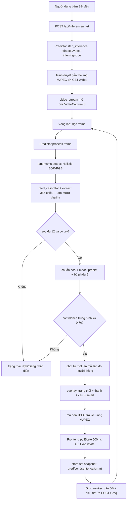
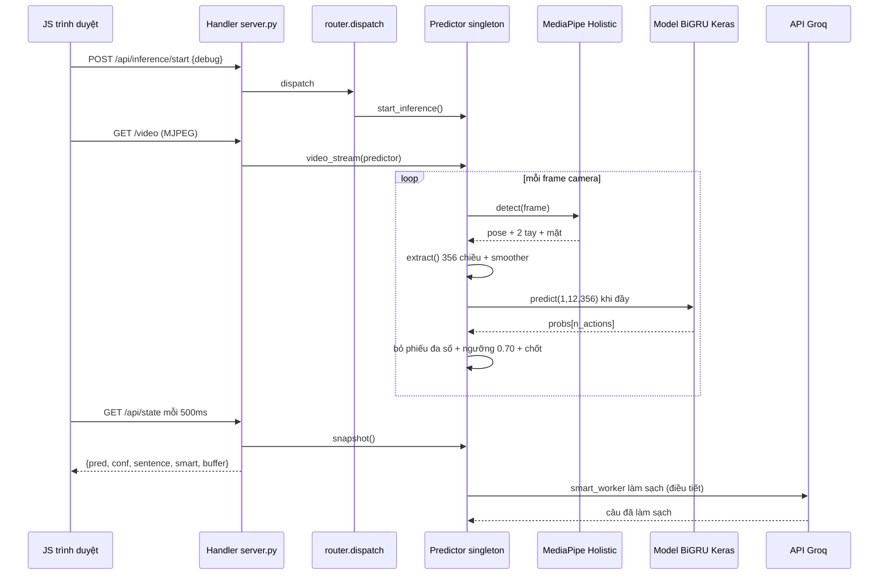

# PROJECT_ARCHITECTURE.md — VSL Translator

## 1. Tổng Quan Dự Án

Bộ dịch Ngôn ngữ ký hiệu Việt Nam (VSL): nhận diện ký hiệu rời rạc qua webcam, ghép câu, làm sạch câu bằng LLM, hỗ trợ giọng nói vào/ra và tra cứu ảnh ký hiệu.

Vòng lặp cốt lõi: `landmark MediaPipe Holistic (từng frame) → vector 356 chiều theo bộ xương chuẩn (canonical-skeleton) → cửa sổ 12 frame → bộ phân loại GRU hai chiều (Keras/TensorFlow) → làm mượt bằng bỏ phiếu đa số → chốt từ → làm sạch câu bằng Groq LLM → overlay + giao diện web + TTS`.

**Ngăn xếp công nghệ chính:**

| Lớp | Công nghệ |
|---|---|
| Tư thế / bàn tay | MediaPipe Holistic 0.10.21 (`model_complexity=2`, `min_detection/tracking=0.01`, `smooth_landmarks=True`), thu hình/kết xuất bằng OpenCV |
| Học máy | TensorFlow 2.18.1 + Keras (`Bidirectional GRU`, `Masking`, `LayerNormalization`, `CategoricalFocalCrossentropy`), scikit-learn (`train_test_split`, `compute_class_weight`, báo cáo), SciPy (`interp1d` cho time-warp) |
| Script backend | CLI Python trong `backend/scripts/` (`train.py`, `realtime_predict.py`, `convenient_predict.py`, `collect_data.py`, `groq_client.py`, `overlay.py`, `manage_classes.py`, `manage_model.py`) |
| Web server | Chỉ dùng stdlib: `http.server.ThreadingHTTPServer + BaseHTTPRequestHandler`, không Flask/FastAPI/Django; bảng điều phối tự viết trong `app/router.py` |
| Giao diện web | HTML/CSS tĩnh + module JS thuần (`static/js/api/*`, `store/store.js`, `ui/*`, `sign/*`); luồng MJPEG dạng thẻ `` tại `GET /video` |
| Giọng nói | `SpeechRecognition 3.17.0 + PyAudio` (STT, `vi-VN`, backend Google), `gTTS 2.5.4` (TTS, `lang=vi`, `tld=com.vn` → dự phòng `com`) |
| Làm sạch bằng LLM | Client `openai` trỏ tới endpoint tương thích OpenAI của Groq (`GROQ_BASE_URL`, model mặc định `qwen/qwen3.8-27b`, temp 0, `max_tokens=256`), mẫu prompt `backend/TXT_NOISE_RMV_PROMPT.md` với ô giữ chỗ `{{Predict}}` |
| Nhãn | 7 lớp trong `backend/actions.json`: `diachi, camon, xinchao, toi, khoer, khochiu, tambiet` |
| Sản phẩm tạo ra | `backend/models/model.keras + feature_stats.npz + test_set.npz`, thư mục `models/backups/backup_*` theo thời gian, `logs/` cho TensorBoard |

## 2. Kiến Trúc Tổng Th

Phong cách: **monolith phân lớp với hai front-end dùng chung một lõi suy luận**.

- **Thư viện lõi ML** (`backend/src/vsl_translator/`): hàm thuần cho đặc trưng (`landmarks.py`), dữ liệu (`dataset.py`), mô hình (`model.py`), điều khiển huấn luyện (`callbacks.py`). Không có tác dụng phụ I/O ngoài đọc config.
- **Lớp batch/CLI** (`backend/scripts/`): huấn luyện, thu thập dữ liệu, đánh giá offline, vòng lặp realtime OpenCV độc lập. Dùng để phát triển mô hình.
- **Lớp dịch vụ web** (`frontend/`): HTTP server dùng stdlib + `routes/` (adapter HTTP mỏng) + `services/` (singleton có trạng thái + logic nghiệp vụ) + giao diện JS tĩnh. `services/predictor.py` là bản chuyển từng dòng từ `scripts/realtime_predict.py:main()` thành phương thức `Predictor.process(frame)` theo từng frame, để đường web và đường CLI không thể lệch nhau.
- **Xuyên suốt**: `backend/config.py` là nguồn sự thật duy nhất (đường dẫn, siêu tham số, ngưỡng, cấu hình Groq, bộ nạp `.env`, `set_groq_api_key()`).

Mô hình đồng thời: HTTP server đa luồng (mỗi request một luồng) + một vòng lặp thu hình OpenCV do luồng xử lý `/video` sở hữu + một luồng daemon Groq `smart_worker` cho mỗi `Predictor` + một luồng `listen_in_background` cho STT. Trạng thái dùng chung được bảo vệ bằng `threading.Lock` bên trong `Predictor`, `SmartSentence`, `SpeechToText`.

```
[Webcam] → [MediaPipe] → [extract() 356 chiều] → [deque(12)] → [chuẩn hóa → GRU → bỏ phiếu(5)]
    → [danh sách câu] → [Groq worker] → [overlay MJPEG + JSON /api/state + gTTS/SR]
```

## 3. Cấu Trúc Thư Mục

```text
vsl-translator/
├── requirements.txt              # tf, mediapipe, opencv, sklearn, openai, gtts, SR, PyAudio
├── README.md                     # ghi chú pipeline + cách dùng CLI
├── PROJECT_ARCHITECTURE.md       # file này
├── backend/
│   ├── config.py                 # hằng số trung tâm, bộ nạp .env, bộ nạp actions
│   ├── actions.json              # 7 nhãn lớp
│   ├── .env                      # GROQ_API_KEY (ghi bởi PUT /api/config/groq-key)
│   ├── TXT_NOISE_RMV_PROMPT.md   # mẫu system prompt cho Groq
│   ├── src/vsl_translator/       # lõi ML có thể import
│   │   ├── landmarks.py          # detect/draw/extract, calibrator/smoother, hằng số chiều
│   │   ├── dataset.py            # nạp/tăng cường/chuẩn hóa, giữ nguyên mặt nạ zero
│   │   ├── model.py              # build_model(), các lớp WeightedMean, Slice
│   │   └── callbacks.py          # CosineAnnealingWarmup, TrainingMonitor, SmartEarlyStopping
│   ├── scripts/                  # điểm vào CLI
│   │   ├── train.py              # chia train/val/test chống rò rỉ + tăng cường + checkpoint
│   │   ├── realtime_predict.py   # vòng lặp live OpenCV (logic suy luận tham chiếu)
│   │   ├── convenient_predict.py # predict theo batch đúng 12 frame + Groq đồng bộ
│   │   ├── collect_data.py       # thu .npy qua webcam theo từng action
│   │   ├── predict.py / predict_live.py / realtime_test.py / cam_test.py
│   │   ├── groq_client.py        # call_groq, SmartSentence, smart_worker
│   │   ├── overlay.py            # chữ Unicode PIL, thanh confidence, panel câu
│   │   ├── manage_classes.py / manage_model.py / add_noise.py / migrate_data.py
│   ├── tests/                    # test_arm_depths, test_far_bias, test_universal_connector
│   ├── data/<action>/<seq>/*.npy # chuỗi 12 frame đã thu thập
│   ├── models/                   # model.keras, feature_stats.npz, test_set.npz, backups/
│   └── logs/                     # log TensorBoard
└── frontend/
    ├── server.py                 # ThreadingHTTPServer + Handler (GET/POST/PUT/DELETE)
    ├── caller.py                 # shim deprecated, re-export services
    ├── app/
    │   ├── router.py             # ROUTES {(method,path): handler} + bản đồ LEGACY 410
    │   ├── routes/               # config, inference, sentences, smart, state, stt, tts, static
    │   └── services/             # predictor, groq_facade, state, video_stream, stt, tts
    ├── static/                   # index.html, css/main.css, js/{api,store,ui,sign}/
    └── assets/signs/ + static/signs/  # ảnh tham chiếu từng chữ/thanh dấu
```

Bỏ qua/không quan trọng: `venv/`, `__pycache__/`, `.git/`, `graphify-out/`, `.DS_Store`, các bản sao cũ `backend/data_*`.

## 4. Module & Thành Phần Cốt Lõi

### 4.1 `backend/src/vsl_translator/landmarks.py` (708 dòng) — trích xuất đặc trưng

Module này biến kết quả thô của MediaPipe Holistic thành vector 356 chiều bất biến với vóc dáng người và khoảng cách camera. Ý tưởng trung tâm là bộ xương chuẩn (canonical skeleton): thay vì dùng tọa độ pixel tuyệt đối, mọi khớp được tái dựng lại trong một hệ tọa độ chuẩn rồi mới đưa vào mô hình.

- `create_model()` dựng `mp_holistic.Holistic` từ giá trị trong `config.py`.
- `detect(image, model)`: BGR→RGB, `flags.writeable=False`, `model.process()`, chuyển ngược lại. Hàm thuần theo từng lần gọi.
- `extract(results, frame_shape, neutral_lens) → np[356]`: hợp đồng mà mọi thành phần khác phụ thuộc.

```mermaid
flowchart TD
    A[results: pose + 2 tay + mặt] --> B{vai 11/12 đủ visibility 0.5?}
    B -- Không --> Z[trả về zeros 356]
    B -- Có --> C[lấy khớp khuỷu 13/14 + cổ tay 15/16]
    C --> D{mỗi bên: đủ khuỷu + cổ tay?}
    D -- Không --> E[bên đó giữ zero 9 pose + 42 tay + 126 offset]
    D -- Có --> F[FK: vai chuẩn tại ±0.5,0 + vector xương đơn vị × 1.2/1.0]
    F --> G{cổ tay chuẩn y trên 1.75 và |x| dưới 0.95?}
    G -- Có --> E
    G -- Không --> H[ghi 9 số pose + chuẩn hóa tay + offset vai + depth]
    H --> I[nối 18 + 42 + 42 + 2 + 126 + 126 = 356]
```

#### 4.1.1 Bố cục vector 356 chiều

| Đoạn | Chỉ số | Nội dung |
|---|---|---|
| Pose trái | [0:9] | vai trái, khuỷu trái, cổ tay trái, mỗi khớp 3 số `(x, y, vis)` |
| Pose phải | [9:18] | vai phải, khuỷu phải, cổ tay phải |
| Tay trái | [18:60] | 21 điểm tay trái, mỗi điểm 2 số `(x, y)` đã chuẩn hóa |
| Tay phải | [60:102] | 21 điểm tay phải, tương tự |
| Độ sâu tay | [102:104] | tỉ số rút ngắn phối cảnh của tay trái và tay phải |
| Offset vai–tay trái | [104:230] | 21 điểm × 3 neo × 2 tọa độ = 126 |
| Offset vai–tay phải | [230:356] | tương tự cho tay phải |

Mặt, thân dưới và trục z của pose bị loại bỏ. Trục z chỉ còn xuất hiện gián tiếp qua số hạng hiệu chỉnh trong `arm_depths`. Visibility được giữ nguyên, không chuẩn hóa.

#### 4.1.2 Nhóm pose 18 chiều — ghim vai + động học thuận

Tọa độ thô của MediaPipe phụ thuộc chiều cao, tỉ lệ tay và khoảng cách camera nên không thể so sánh trực tiếp giữa các phiên. Hàm `_retarget_arm` khắc phục bằng cách ghim hai vai vào vị trí cố định rồi tái dựng tay theo hướng xương gốc:

1. Vai trái ghim tại `(-0.5, 0)`, vai phải tại `(+0.5, 0)`.
2. Tính vector xương thô `upper = khuỷu − vai`, `fore = cổ tay − khuỷu` trong tọa độ chuẩn hóa của ảnh.
3. Chuẩn hóa mỗi vector thành vector đơn vị bằng `_unit_vec`; vector rỗng hoặc không hữu hạn trả về `(0, 0)` để hàm giữ thuần túy theo từng frame, không rò rỉ hướng từ frame trước.
4. Khuỷu chuẩn = vai chuẩn + hướng trên × `STD_UPPER_ARM (1.2)`; cổ tay chuẩn = khuỷu chuẩn + hướng dưới × `STD_FOREARM (1.0)`.

Kết quả: tay dài hay ngắn, đứng gần hay xa camera đều cho cùng độ dài chuẩn, chỉ còn hướng chuyển động được giữ lại. Tay đứng yên cho tư thế ổn định khác zero, tay chuyển động cho quỹ đạo hướng rõ ràng.

#### 4.1.3 Nhóm tay 84 chiều — chuẩn hóa theo lòng bàn tay của chính nó

Mỗi bàn tay được xử lý độc lập trong `_process_hand`, không tham chiếu vai hay mặt:

1. Lấy 21 điểm `(x, y)` thô của `left_hand_landmarks` hoặc `right_hand_landmarks`; sai hình dạng trả về `zeros(42)`.
2. Tịnh tiến mọi điểm về cổ tay của chính detector đó: `pts − pts[0]`.
3. Tính `palm_size = max(|cổ tay − mcp9|, |mcp5 − mcp17| × 1.25)`. Nhánh max giữ tỉ lệ ổn định khi tay xoay về phía camera làm một trục co lại nhưng trục còn lại vẫn sống sót.
4. Chia cho `palm_size`, nhân với `STD_PALM (0.4)`, dẹt thành 42 số.

Ngưỡng `MIN_PALM_SIZE (0.012)` lọc lòng bàn tay suy biến; dưới ngưỡng trả về `zeros(42)`. Nhờ đó tay to hay nhỏ, gần hay xa đều cho cùng thang đo, mô hình chỉ học hình dáng và vị trí tương đối của các ngón quanh cổ tay.

#### 4.1.4 Nhóm offset vai 252 chiều — vị trí tay so với thân trên

Pose chuẩn cho biết tay đang ở tư thế nào, tay chuẩn cho biết hình dáng ngón, nhưng cả hai đều mất thông tin tay đang ở đâu trước ngực hay mặt. Nhóm `_shoulder_offsets` bù lại bằng vector từ mỗi điểm tay tới 3 neo trên thân:

1. `_get_face_center` lấy tâm mặt: ưu tiên trung điểm hai tai pose (7, 8) cùng hệ tọa độ với tay; dự phòng trung điểm hai khóe mắt ngoài face-mesh (33, 263).
2. `_get_raised_shoulders` giữ nguyên x của vai trái/phải, nâng y lên bằng y tâm mặt, được trung điểm hai vai nâng; thiếu vai hoặc thiếu mặt trả về ba neo rỗng.
3. Mỗi tay tính `(21 điểm − neo) / palm_size × 0.4` cho từng neo theo đúng thứ tự vai trái nâng, vai phải nâng, trung điểm; dẹt mỗi khối thành 42, nối thành 126 mỗi tay.

Palm dùng chung với `_process_hand` qua `_palm_size` nên cùng thang đo. Tay mất, neo mất hoặc palm suy biến cho `zeros(126)` ở bên đó, frame còn lại nguyên vẹn.

#### 4.1.5 Nhóm độ sâu tay 2 chiều — bù phối cảnh tiến/lùi camera

Khi tay đưa về phía camera, độ dài 2D co ngắn nhưng mô hình 2D không thấy trục sâu. Hàm `_compute_arm_depth_ratio` ước lượng hiệu ứng này theo từng tay:

1. Đo độ dài pixel `|vai−khuỷu| + |khuỷu−cổ tay|` khi có `frame_shape`, nếu không dùng tọa độ chuẩn hóa.
2. Chia cho `neutral_len` của phiên đó; không có hiệu chuẩn thì dùng tổng chuẩn `1.2 + 1.0`.
3. Cộng số hạng phụ `Z_GAIN (2.0) × (wrist.z − shoulder.z)`; z của MediaPipe âm khi tiến về camera nên tỉ số giảm xuống dưới 1.0 đúng vật lý.
4. Kẹp vào `[0.3, 2.0]`, mặc định `1.0` khi bên đó bị chặn.

`ArmDepthCalibrator` hiệu chuẩn `neutral_len` theo từng phiên: thu độ dài tay pixel từ các frame không nghỉ, loại mẫu ngoài `[1.5, 4.0] × shoulder_width`, lấy trung vị sau `ARM_DEPTH_CAL_WARMUP (20)` frame. `ArmDepthSmoother` lọc EMA α=0.4 trên trung vị cửa sổ 5, chỉ áp trên đường live để dữ liệu train giữ nguyên thô. `feed_calibrator` là cầu nối cho mỗi frame: trích khớp, tính độ dài pixel, nạp vào calibrator.

#### 4.1.6 Cổng chặn và hằng số

- Vai thiếu hoặc `visibility < 0.5` → cả frame `zeros(356)`; lớp `Masking(0.0)` của mô hình sẽ bỏ qua frame này trong bước hồi tiếp.
- Thiếu khuỷu/cổ tay một bên → 9 số pose + 42 số tay + 126 số offset của bên đó giữ zero, bên còn lại nguyên vẹn.
- Cổng tay nghỉ: cổ tay chuẩn có `y > IDLE_WRIST_Y_MAX (1.75)` và `|x| < IDLE_WRIST_X_MAX (0.95)` → coi như tay buông thõng, zero hóa bên đó nhưng vẫn giữ giá trị depth vừa đo.
- Overlay debug: `draw_landmarks_new`, `draw_shoulder_spokes`, `draw_landmarks_test`, `draw_arm_lengths` vẽ đúng các neo và nan hoa mà `extract()` dùng, giúp đối chiếu trực quan vector đang thu.
- Hằng số: `POSE_DIM=18, HAND_DIM=42, ARM_DEPTH_DIM=2, SH_OFF_REF_DIM=126, SH_OFF_DIM=252, BODY_ONLY_DIM=356, FULL_DIM=1662` (định dạng cũ trước chuyển đổi).

### 4.2 `backend/src/vsl_translator/model.py` — bộ phân loại

`build_model(n_actions, sequence_len=12, n_features=356)`, khẳng định đầu vào 356 chiều:

```text
Input(12,356) → Masking(0.0)
  → Slice theo nhóm → 4× LayerNormalization (pose 18 / tay 84 / depths 2 / sh_off 252) → Concat
  → BiGRU(48, return_sequences) → LN → Dropout(0.4)
  → BiGRU(48, return_sequences) → LN → Dropout(0.4)
  → Dense(1,tanh) điểm số + attention WeightedMean (softmax theo thời gian) → (B,96)
  → Dense(64,relu,l2=1e-4) → LN → Dropout(0.4)
  → Dense(64,relu,l2=1e-4) → LN → Dropout(0.3)
  → Dense(n_actions,softmax)
```

Biên dịch với `Adam(lr=1e-3, clipnorm=1.0)`, hàm mất mát `CategoricalFocalCrossentropy(alpha=1.0, gamma=2.0, label_smoothing=0.05)`, metric `categorical_accuracy`. Lớp tùy biến có thể serialize: `WeightedMean` (gộp attention bằng `ops.softmax` không dùng mask), `Slice` (cắt nhóm đặc trưng nhưng vẫn truyền mask qua).

### 4.3 `backend/src/vsl_translator/dataset.py` — pipeline dữ liệu

- `load_raw_dataset()`: duyệt `data/<action>/<seq>/*.npy`, xếp thành `(N,12,356)` + nhãn one-hot.
- `augment_train_data(X, y, augment_factor=8)`: chỉ trong bộ nhớ, chỉ trên split train — nhiễu Gauss (`NOISE_STD=0.05`), jitter tỉ lệ (`0.05`), biến dạng thời gian (`TIME_WARP_SIGMA=0.2` qua `interp1d` + zero lại mask tại `<0.99`), dịch chuyển (`±0.02`), rớt frame (`0.05`), dropout một tay (`0.5`), hoán đổi tay (`0.3`), chèn tay nghỉ (`0.35`, cổ tay nghỉ y trong `[1.1,1.6]` + trôi `0.015`). `_coord_mask` loại visibility (mỗi kênh pose thứ 3) và tỉ số `arm_depths` khỏi các phép tăng cường tọa độ; mặt nạ `sequence != 0.0` được giữ tuyệt đối.
- `standardize_features(X, mean, std)`: z-score nhưng giữ nguyên giá trị zero tuyệt đối (zero vẫn là zero để `Masking` hoạt động).
- `collect_data.py --action <name>`: thu `N_SEQUENCES=15` × `SEQUENCE_LEN=12` vector qua `extract()` trực tiếp.

### 4.4 `backend/src/vsl_translator/callbacks.py` + `scripts/train.py`

- `CosineAnnealingWarmup(lr_max=1e-3, lr_min=1e-6, warmup=10, total=500)` — bộ điều khiển LR duy nhất.
- `TrainingMonitor` — bảng điều khiển theo từng epoch + cảnh báo khoảng cách overfit (`0.25`).
- `SmartEarlyStopping` — patience 60 / `min_delta=1e-4` từ epoch 30, mục tiêu (`val_acc≥0.98`, `val_loss≤0.05`), patience đột biến loss 15, patience bão hòa 30, patience khoảng cách overfit 30.
- Pipeline `train.py`: sao lưu model cũ (`models/backups/backup_<ts>/`, giữ 5 bản) → nạp raw → chia stratified (giữ lại test 15% trước, rồi chia val 15% trên tổng) → lưu `test_set.npz` → chỉ tăng cường train → thống kê chỉ từ train → `ModelCheckpoint(val_loss)` + TensorBoard → nạp lại trọng số tốt nhất → báo cáo train-aug / train-sạch / val / test giữ lại + ma trận nhầm lẫn + phân tích confidence. Cân bằng lớp bằng `compute_class_weight('balanced')` trên nhãn đã tăng cường.

### 4.5 `scripts/realtime_predict.py` so với `services/predictor.py`

Cùng một máy trạng thái, hai vật chủ: vòng lặp OpenCV độc lập (`main()`, phím Backspace/C/Q) so với singleton web (`Predictor.process(frame)` cho mỗi frame MJPEG). Trạng thái: `seq: deque(12)`, `votes: deque(5)`, `calibrator`, `smoother`, `probs`, `pred_idx`, `no_hand_frames`, `sentence[]`, `last_committed`. Mỗi frame: `detect → feed_calibrator → extract → làm mượt depths[102:104] → nối vào → nếu đầy: chuẩn hóa → model.predict → bỏ phiếu → thắng đa số + confidence trung bình ≥ 0.70 → pred_idx → chốt từ một lần mỗi lần đổi người thắng`. 5 frame liên tiếp không tay sẽ xóa `seq/votes/probs/last_committed`. Overlay qua `scripts/overlay.py` (`put_text_unicode` PIL DejaVu, `draw_confidence_bars`, `draw_sentence`, `draw_sentence_smart`).

### 4.6 `scripts/groq_client.py` + `services/groq_facade.py`

- `call_groq(raw, template, key)`: `OpenAI(base_url=GROQ_BASE_URL).chat.completions.create(model=GROQ_MODEL, temp=0, top_p=1, max_tokens=256)`, system prompt = mẫu đã thay `{{Predict}}`, cắt dấu ngoặc kép/tiền tố `output:`, báo lỗi khi rỗng.
- `SmartSentence`: vật chứa `{text, pending, error, _last_sent, _last_err_time, _force_retry}` an toàn luồng với `set_result/set_error/mark_pending/retry_now/clear/read`.
- `smart_worker(get_sentence, smart, stop, is_active)`: thăm dò mỗi `SMART_POLL_INTERVAL=0.1s`; chỉ gọi khi câu thay đổi, điều tiết `SMART_CALL_INTERVAL=7.0s`, nguội lỗi `SMART_RETRY_INTERVAL=15s`; bỏ qua khi không suy luận trừ khi bị ép.
- `FrontendGroqCaller(get_sentence, is_active)`: sở hữu một `SmartSentence` + worker daemon cho mỗi `Predictor`; `retry()` ưu tiên câu frontend gửi lên, dự phòng câu backend đang giữ, cuối cùng thúc worker. `caller.py` không bao giờ import `groq_client` trực tiếp.

### 4.7 Máy chủ frontend: `server.py` + `app/router.py` + `routes/` + `services/`

- `server.py:Handler` (stdlib, không framework): `POST/PUT` phân tích JSON body → `router.dispatch(method,path,payload)` → JSON `(status, dict)` hoặc nhị phân `(status, bytes, mime)`; `GET /api/*` tương tự; `GET /video` truyền JPEG `multipart/x-mixed-replace` từ `video_stream(predictor)`; còn lại do `routes/static.py` phục vụ trong `static/` (chặn path-traversal), `410` cho các đường `LEGACY`.
- Bảng route (khớp chính xác): `POST /api/inference/start|stop`, `GET|DELETE /api/sentences`, `DELETE /api/sentences/last`, `POST /api/smart/retries`, `PUT /api/config/groq-key`, `GET /api/state|health|stt`, `POST /api/stt/start|stop`, `POST /api/tts` (trả `audio/mpeg`).
- Services: `predictor.py` (singleton model + MediaPipe, bật/tắt suy luận, thao tác câu, `snapshot()`), `state.py` (snapshot hoặc mặc định khi chưa nạp model), `video_stream.py` (`_stream_lock` một client, chỉ mở `cv2.VideoCapture(0)` khi đang suy luận, giải phóng khi dừng/ngắt), `stt.py` (singleton `SpeechToText`, `listen_in_background`, `drain()`), `tts.py` (`synthesize()`: chuẩn hóa → cắt 500 ký tự → cache SHA1 50 + `/tmp/vsl_tts_*.mp3` → `com.vn` rồi `com`).
- JS: `api/client.js` (`request/get/post/put/del`, phong bì `{ok,data|error}`, `ApiError`), mỗi endpoint một module, `store/store.js` (`state` + `set()` + `subscribe`), `main.js` nối nút bấm → API → `store.set` → `renderStatus/renderSentence/renderSmart`; vòng thăm dò `pollState(500ms)`; `/video` gắn/gỡ dạng `` trong `ui/streamView.js`; `sign/` chuyển văn bản gõ thành ảnh tham chiếu `static/signs/*.png`.

## 5. Luồng Dữ Liệu (Sequence/Flow)

### 5.1 Suy luận live trên web (đường chính)





### 5.2 Đường huấn luyện

```mermaid
flowchart LR
    A[collect_data.py: 15 chuỗi x 12 frame .npy] --> B[load_raw_dataset]
    B --> C[chia stratified: giữ lại test 15 phần trăm]
    C --> D[chia stratified: train / val]
    D --> E[augment_train_data x8 chỉ trên train]
    E --> F[standardize_features thống kê chỉ từ train]
    F --> G[build_model BiGRU + focal loss]
    G --> H[fit: CosineWarmup + Monitor + SmartEarlyStop + Checkpoint + TensorBoard]
    H --> I[nạp lại trọng số val_loss tốt nhất]
    I --> J[đánh giá train-aug / train-sạch / val / test giữ lại + ma trận nhầm lẫn]
```



## 6. Design Pattern

- **Singleton (khóa kiểm tra kép)**: `Predictor.get/peek`, `SpeechToText.get` — một model, một camera, một mic mỗi tiến trình; `_instance_lock` + `_lock` instance để an toàn từng trường.
- **Facade**: `FrontendGroqCaller` che `SmartSentence + smart_worker + retry_smart_sync` khỏi `Predictor`; `routes/*` che chi tiết service khỏi `server.py`.
- **Router bảng điều phối**: `router.ROUTES[(method,path)]` thay cho framework; bản đồ `LEGACY` trả `410 Gone` kèm con trỏ `migrated_to`.
- **Worker nền / thăm dò**: luồng Groq `smart_worker` (điều tiết + nguội lỗi + cổng `is_active`), callback `listen_in_background` của STT → bộ đệm → `drain()` khi thăm dò, frontend `pollState(500ms)` thay vì websocket.
- **Bộ tích lũy trạng thái với sentinel mặt nạ zero**: cửa sổ trượt `deque(12)` + `Masking(0.0)`; frame toàn zero (mất vai / rớt frame / tay nghỉ) vẫn đi qua mạng nhưng bị mask trong bước hồi tiếp; cả tăng cường và chuẩn hóa đều giữ nguyên `0.0` tuyệt đối.
- **Chuẩn hóa theo nhóm**: `Slice` (truyền mask qua) + 4× `LayerNormalization` trước khối hồi tiếp — chuẩn hóa độc lập pose/tay/depths/offsets thay vì một norm toàn cục.
- **Gộp attention**: `WeightedMean` (điểm `Dense(1,tanh)` → `softmax` theo thời gian → trung bình có trọng số) thay cho đọc trạng thái cuối.
- **Template method / lõi dùng chung**: `realtime_predict.main()` và `Predictor.process()` thực hiện cùng thứ tự các bước; `convenient_predict` tái dùng cùng chuỗi `detect→calibrate→extract→smooth→standardize→predict→threshold` cho batch.
- **Adapter**: `caller.py` là shim deprecated re-export `app.services.*`; `overlay.py` là adapter chữ Unicode PIL trên frame OpenCV; adapter client OpenAI dùng cho Groq.
- **Observer (frontend)**: `store.subscribe(fn)` phát bản vá trạng thái tới `statusView/sentenceView/smartView`.
- **Cache-aside**: TTS SHA1→bộ nhớ (50) + `/tmp/vsl_tts_*.mp3`; `feature_stats.npz` + `test_set.npz` lưu cạnh model.

## 7. Hạ Tầng & Cấu Hình

- **Phụ thuộc** (`requirements.txt`): `tensorflow==2.18.1, opencv-python, mediapipe==0.10.21, scikit-learn, openai, gtts==2.5.4, SpeechRecognition==3.17.0, PyAudio==0.2.14`. Không web framework, không Docker, không file CI trong repo.
- **Chạy**: `python -m venv venv && pip install -r requirements.txt`; CLI huấn luyện chạy bằng `venv/bin/python scripts/*.py` từ `backend/` (script tự chèn `../src` + `..` vào `sys.path`); web server `python frontend/server.py` → `http://127.0.0.1:8000` (chỉ `ThreadingHTTPServer` stdlib). Service frontend chèn `backend + backend/src + backend/scripts` vào `sys.path` khi import.
- **Cấu hình** (`backend/config.py`, ghi đè được qua env): đường dẫn (`DATA_DIR, MODELS_DIR, BACKUP_DIR, LOGS_DIR, MAX_BACKUPS=5`), nhãn (`actions.json` → `ACTIONS/LABEL_MAP`), thu thập (`N_SEQUENCES=15, SEQUENCE_LEN=12`), MediaPipe (ngưỡng `0.01/0.01`, complexity 2), các hằng số đặc trưng/tăng cường/LR/focal-loss/early-stop đã liệt kê ở §4, suy luận (`CONFIDENCE_THRESHOLD=0.70, SMOOTHING_WINDOW=5`), Groq (`GROQ_MODEL/BASE_URL/TIMEOUT=30/RETRIES=1`, `SMART_CALL=7s/RETRY=15s/POLL=0.1s`, `GROQ_API_KEY` từ `.env`, lưu bởi `set_groq_api_key()` và worker đọc trực tiếp — không cần restart).
- **Vòng đời model**: `train.py` tự sao lưu `model.keras + feature_stats.npz` vào `backups/backup_<ts>/` (xoay vòng 5) trước khi ghi đè; `manage_model.py / manage_classes.py` xử lý thêm/đổi tên lớp và nâng cấp model; `migrate_data.py` cố ý vô hiệu hóa — vector đã lưu bị khóa theo bố cục, đổi chiều phải thu lại dữ liệu.
- **Điểm yếu đã biết**: giả định đường dẫn tuyệt đối giữa `frontend/` và `backend/` (thủ thuật `sys.path`, không phải package); khóa camera toàn cục duy nhất (client `/video` thứ hai nhận `camera busy`); file model bắt buộc ở lần `Predictor.get()` đầu tiên nếu không route trả 500; Groq/STT/TTS phụ thuộc mạng với dự phòng cục bộ (giữ smart text cũ, hiện lỗi kết nối STT, thử lại TTS `com.vn→com`).
